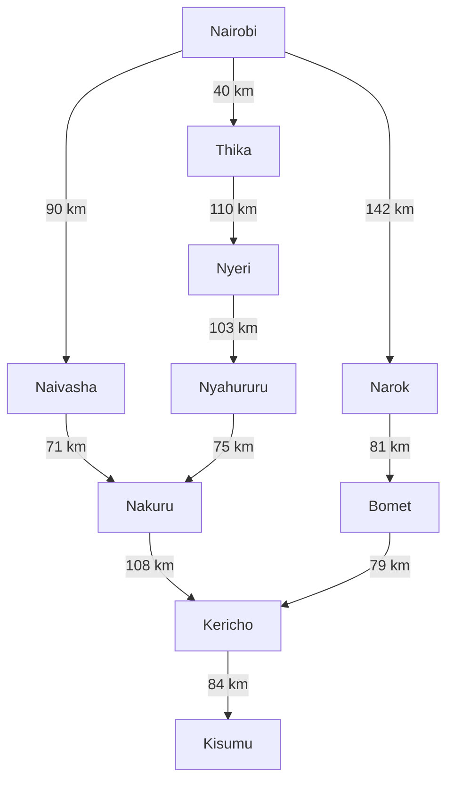
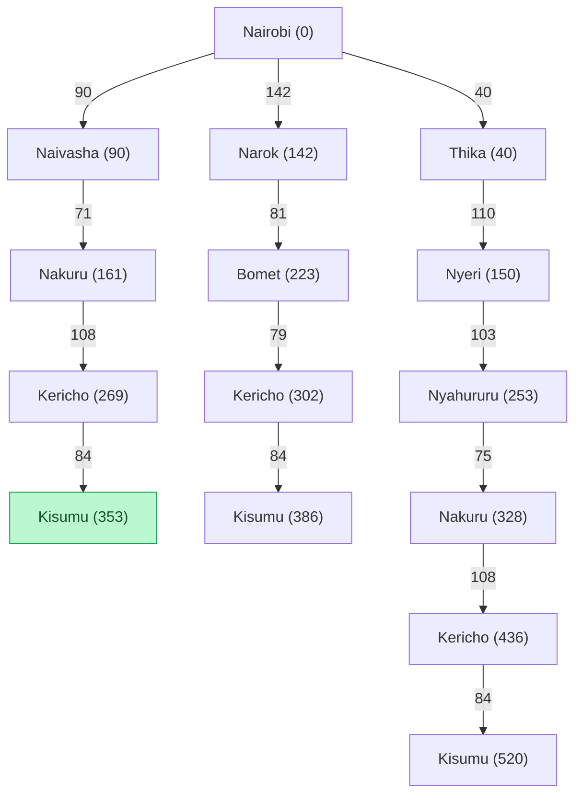

# Groupwork  Practical Exercise 3: Designing a Searching Agent

## Group members

Ahmed Najma Wanjiku - 192797  [Graph and search tree] [Link]

 
Mureithi Davidtelios -  [PEAS and agent design] [Link]

Mungai Patrick -  [UCS and calculations] [Link] 
## 1. Self-driving trailer as an intelligent agent

### 2.3 Distance measurements

| From | To | Distance (km) |
|---|---|---:|
| Nairobi | Naivasha | 90 |
| Naivasha | Nakuru | 71 |
| Nakuru | Kericho | 108 |
| Kericho | Kisumu | 84 |
| Nairobi | Narok | 142 |
| Narok | Bomet | 81 |
| Bomet | Kericho | 79 |
| Nairobi | Thika | 40 |
| Thika | Nyeri | 110 |
| Nyeri | Nyahururu | 103 |
| Nyahururu | Nakuru | 75 |

### 2.4 Weighted directed graph

### 2.5 Search tree of potential routes

.

## 3. Finding the optimal path

## group photo

